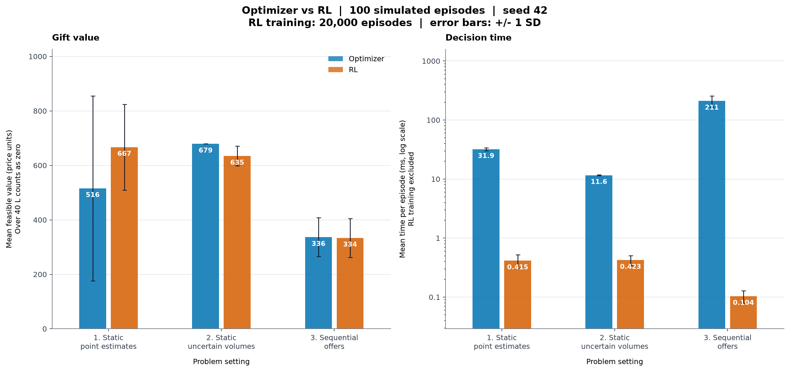

# Learning to choose gifts: optimization vs reinforcement learning

> **Research question:** Is it better to calculate the best decision every
> time, or to learn how to make good decisions in advance?

This project uses [Zalando's Gift Problem](<./Zalando's Gift Problem.txt>) to
compare a mathematical optimizer with a reinforcement learning (RL) agent. We
start with the original static problem, then add uncertainty and sequential
offers to explore when a learned policy might be useful.

## The story

Ahmad wants to choose the most valuable birthday gifts for Sergey, but his
backpack holds only **40 liters**. Anna collected the item prices in
[`items.json`](./items.json). Oliver accidentally deleted the item volumes,
so the only volume data come from past packages in
[`packages.json`](./packages.json). Each measurement is the sum of its item
volumes plus noise, described as normally distributed with mean 0 and
variance 2.

We first estimate individual volumes from those package measurements. We
assume Ahmad can select **at most one of each item**. The original statement
only says items do not repeat within a historical package; applying this rule
to gift choices is our assumption.

## The two approaches

- **Optimizer:** 0/1 knapsack solved by mixed-integer linear programming
  (**SciPy MILP / HiGHS**). For sequential offers, it replans using sampled
  future scenarios.
- **RL agent:** **REINFORCE** policy-gradient agent with a linear stochastic
  policy and a fitted linear value baseline.

The current RL agent is deliberately simple. It is not a claim about all RL
methods.

## The three settings

| Setting | Ahmad's situation | What we want to learn |
|---|---|---|
| **1. Static, point estimates** | All items are available. Ahmad treats each estimated average volume as exact and packs up to 40 liters. | What does the basic solution choose, and what happens if the estimates are wrong? |
| **2. Static, uncertain volumes** | All items are available, but both methods use the same conservative volume allowance. | How does leaving a safety margin affect value and simulated fit? |
| **3. Sequential offers** | Twelve distinct offers arrive one at a time. Ahmad must accept or reject each before the next appears. | Can a trained agent make good decisions faster when this problem is repeated? |

Settings 1 and 2 are static: the optimizer can choose the whole set at once,
while the RL agent considers the known catalog in a random order and cannot
revisit rejected items. Setting 1 is a **diagnostic baseline**, not a
comparison between two risk-aware strategies. Both methods use point
estimates there; neither is explicitly optimized for the plotted
zero-if-overweight score.

In setting 3, the catalog and number of offers are known, but neither method
knows the actual future sequence. For each optimizer decision, the experiment
samples four possible future offer sets, compares accepting and rejecting the
current offer, and averages the results. Within each sample, the optimizer
assumes perfect knowledge of that sampled future, so this is an optimistic
approximation, not an exact multistage solution. An offline solver that knows
the whole offer sequence is saved as a reference upper bound, but is not shown
as an online competitor in the plot.

For settings 2 and 3, both methods use the same conservative capacity rule.
Each item's weight is its fitted mean plus a Gaussian upper quantile at tail
probability `risk / number_of_items`; these weights must sum to at most 40
liters. With the default risk of 5%, the union bound gives a sufficient but
potentially conservative rule under the assumed volume model. It is not an
exact chance-constrained optimum or a real-world guarantee.

## How we evaluate

Each method faces the same offers and sampled volumes **within an evaluation
episode**. Training and evaluation use separate random streams.

- **Selected value:** the total price of chosen gifts, whether or not they fit.
- **Feasible value:** selected value if the simulated gifts fit; otherwise,
  zero. This is the value shown in the plot.
- **Violations:** how often simulated volume exceeds 40 liters.
- **Decision time:** wall-clock decision time per episode. RL training, volume
  estimation and episode generation are excluded.

The 100 simulated episodes in the displayed run are samples from an estimated
volume model, not repeated measurements of the actual gifts. Zero observed
violations does not prove a zero violation probability.

## What did we find?

The displayed run uses **20,000 RL training episodes**, **100 evaluation
episodes**, seed 42, and four planner scenarios in setting 3:

| Setting | Optimizer: feasible value | RL: feasible value | Simulated violations, optimizer / RL |
|---|---:|---:|---:|
| 1. Point estimates | 515.9 | 667.1 | 30 / 100; 5 / 100 |
| 2. Uncertain volumes | 679.0 | 634.5 | 0 / 100; 0 / 100 |
| 3. Sequential offers | 336.4 | 333.9 | 0 / 100; 0 / 100 |



The left panel shows **mean feasible gift value**; oversized simulated
selections count as zero. The right panel shows **mean decision time per
episode** on a logarithmic scale, excluding RL training. Error bars show
plus or minus one sample standard deviation, not confidence intervals. A
downward triangle, when present, means a lower time error bar was clipped at
the log-axis floor.

**Why does the optimizer score lower in setting 1?** It selects gifts worth
737 using estimated volumes, but its selection exceeds capacity in 30 of the
100 simulated volume draws. The plotted metric counts those cases as zero:
`737 * 70% = 515.9`. RL's average selected value is lower, but its selections
violate capacity less often in this run. This does **not** mean RL found a
better solution to the optimizer's point-estimate objective.

**A scenario where learning ahead may help:** in setting 3, RL achieves nearly
the optimizer's feasible value while taking about **0.104 ms per episode**
for decisions, compared with about **211 ms** for the sampled-future planner
in this run. RL training took about **1.8 seconds** upfront and is not included
in those decision times. For many repeated decisions under tight time
constraints, learning ahead may therefore be valuable.

This is a **conditional yes**, not a universal result. The methods have
different value and compute trade-offs; the timing depends on this
implementation and hardware. In the static settings, the optimizer is
re-solved each episode even though its input is unchanged, so caching its
solution would change the timing comparison. The sequential value gap is
uncertain, and the simulator's assumptions may not reflect real shopping.

## Volume estimation and limitations

We use 80% of historical packages to fit nonnegative item volumes by least
squares and 20% for validation. For seed 42, validation package-volume RMSE
is approximately **2.19 liters**, compared with the stated measurement-noise
standard deviation of about **1.41 liters**. This mismatch is a warning that
the assumed noise model may not fit the data well.

For evaluation, correlated item volumes are sampled from a Gaussian
approximation centered on the fitted means, with covariance
`2 * inverse(X.T @ X)` from the training design matrix; negative draws are
clipped to zero. This is not a full Bayesian posterior or a validated model of
true volumes. The actual volumes are unknown, and the offer sequences in
setting 3 are simulated; neither the fit rate nor the gift choices are proven
to hold in reality.

## Run the project

Requires Python 3.10 or later:

```sh
python3 -m venv .venv
.venv/bin/python -m pip install -r requirements.txt
.venv/bin/python -m unittest discover -s tests -v
.venv/bin/python -m gift_experiment --episodes 100 --training-episodes 20000
.venv/bin/python -m gift_experiment.plot
```

The experiment writes `results/experiment.json`; the plot command writes
`results/experiment.png`. Results include estimated volumes, covariance,
trained policy parameters, episode outcomes and per-episode decision times.
Older result files without per-episode timings must be regenerated to draw
error bars. The input files are never modified. The default experiment uses
30 evaluation episodes; the command above uses 100 to match the displayed run.

### Explore training length

```sh
.venv/bin/python -m gift_experiment.training_sweep \
  --training-episodes 4000 20000 100000 --training-seeds 1 2 3 \
  --episodes 100 --horizon 12 --scenarios 4
.venv/bin/python -m gift_experiment.plot --training-sweep results/training_sweep.json
```

This writes `results/training_sweep.json` and `results/training_sweep.png`. It
holds the volume-model split, evaluation episodes and planner randomness
fixed while varying RL training length and seed. Paired confidence intervals
describe evaluation-episode variability for each policy, not uncertainty
across training seeds or volume models. Use new validation and test episodes
before selecting a training length.

### Explore the optimizer's planning budget

```sh
.venv/bin/python -m gift_experiment.sweep \
  --horizons 6 12 20 --scenario-counts 1 4 8 \
  --seeds 42 43 44 --episodes 100 --training-episodes 20000
.venv/bin/python -m gift_experiment.plot --sweep results/sweep.csv
```

This writes `results/sweep.csv` and `results/sweep.png`. More scenarios and
episodes can make the sweep slow. It reports paired value differences, Wilson
violation intervals, decision times and an approximate *compute-time-only*
break-even: RL training time divided by the per-episode decision-time saving.
That break-even is not a quality or financial break-even. Use `--help` on each
module for options.

